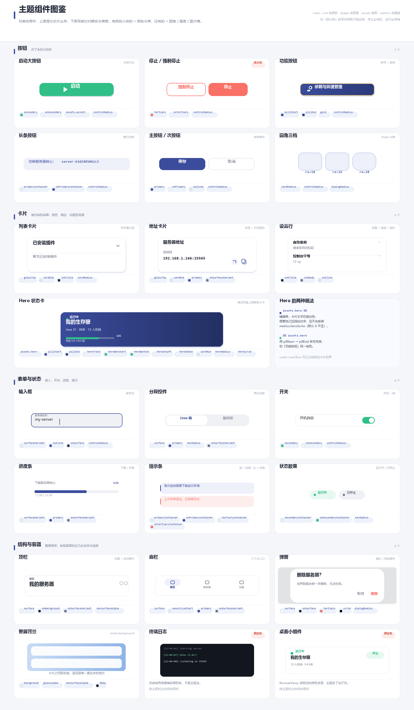
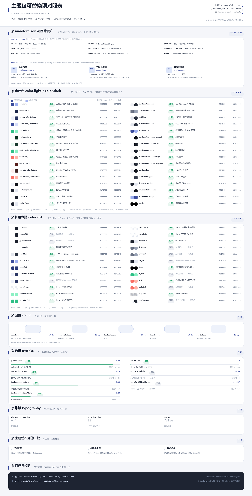

# 主题包可替换的内容（`.mctheme` v1）

给「做主题」的人看的落点清单：**写了这个键，界面上哪一块会变**。
规范与校验规则见 `_theme_kit` 的 `主题包制作指南.md`；本文件只列本 App 已接线的落点。

> **三份材料分工**：
> - `theme-parts.png` / `theme-parts.svg` — **组件图鉴**：把 App 里能换肤的零件逐个画出来，
>   每个零件下面挂着它归哪些令牌管。做主题时先在这里认零件。
> - `theme-spec.png` / `theme-spec.svg` — **逐键对照表**：每个令牌的默认值（明/暗两套）、
>   落点与「生效 / 预留」状态。查默认值和写法看这张。
> - `theme-source/` — **素材源**：每个零件按真实 dp 尺寸单独导出的 SVG / 3x 透明 PNG，
>   给「生图重绘 → 矢量化」用。见 `theme-source/README.md`。
>
> 前两张由 `tools/gen-theme-parts.py` / `tools/gen-theme-spec.py` 生成，素材源由
> `tools/gen-theme-source.py` 生成；改代码里的令牌名或尺寸后重跑即可同步。

## 一、图片资产（`manifest.assets`）

| 槽位 | 落在哪 | 建议尺寸 | 缺省行为 |
|---|---|---|---|
| `background` | 全屏背景，铺在所有页面底下 | 1080×2340 ~ 1440×3200 | 用 `color.*.background` 纯色 |
| `hero` | 概览页「服务器状态」大卡 | 1254×648（≈1.94:1） | `primary → pillEnd` 竖向渐变 |
| `accent` | 概览页底部「启动服务器」长条按钮，**只在未运行状态** | 1188×159（≈7.5:1） | `secondary`（绿）纯色填充 |





三条硬规矩：

1. `hero` 是**替换**而不是叠加：卡片里的文字始终是白的，图自己得压得住白字（左半留深色）。
   图偏亮就把 `metrics.heroScrim` 调到 0.35–0.55，会压一层黑；默认 0 = 不压。
2. `accent` 只在「可以启动」时出现。运行中会切成「强制停止 / 停止」的珊瑚色语义按钮，
   **任何主题都改不掉这两个的红色**——用户要靠它认出危险操作。
3. `background` 铺满整屏，但所有内容都在卡片里（玻璃卡 94% 不透明），所以实际能看到背景的是：
   卡片之间的缝隙、顶栏（半透明）、底部导航条（半透明）。

### 让插画探出卡片 / 按钮（`assetsMeta.*.scale`）

默认 `crop`：图被裁在卡片（按钮）边框之内。想让角色、翅膀、飘带伸出边界，在 manifest 里声明：

```json
"assetsMeta": {
  "hero":   { "width": 1254, "height": 648, "scale": "overflow" },
  "accent": { "width": 1188, "height": 159, "scale": "overflow" }
}
```

- `hero` 溢出：立绘按卡片高度等比放大 12%、靠右居中，**不再裁切**，可以探出上下边缘；
  卡片本体的圆角和描边仍在，`metrics.heroScrim` 只压在卡片范围内。
- `accent` 溢出：插画高 1.18×、宽 1.06×，可以探出按钮上下左右；按钮本体仍保持点击区域与圆角。
- 溢出量是固定的（够用且不会压到相邻卡片）。真正决定「探出多少」的是**画布留白**：
  想让角色多探出 20dp，就要在图画布上方留出对应的透明空间。

## 二、配色（`tokens.color.light/dark`，32 个角色）

整套 Material3 角色色，跟着换。最影响观感的 8 个：`background` `surface` `onBackground`
`onSurface` `primary` `onPrimary` `secondary`（成功/运行中）`tertiary`（危险/停止）。

`secondary` 必须是绿/青/蓝系，`tertiary` 必须是红/橙系 —— 语义不能反转。

## 三、扩展令牌（`tokens.ext.light/dark`，24 个）

| 令牌 | 落点 |
|---|---|
| `glassTop` + `metrics.glassAlpha` | 所有卡片底色（有背景图时半透，背景能从卡里透出来） |
| `glassRim` | 玻璃卡顶部那道高光描边 |
| `cardRim` | 卡片 1dp 描边 / Hero 卡描边 |
| `inkTitle` | 卡片标题文字 |
| `heroTrack` / `heroBarStart` / `heroBarEnd` | Hero 卡里 CPU / 内存进度条的轨道与填充 |
| `heroOnSoft` / `heroOnDim` | Hero 卡上的主文字 / 次要文字（默认白色 90% / 70%） |
| `pillStart` → `pillEnd` | 概览页右上角「依赖与环境管理」按钮的底色渐变；Hero 无插画时的兜底渐变 |
| `gold` | 「依赖与环境管理」按钮的 1dp 描边（**只有显式写了这个键才画**，用于金线皮肤）；`goldInk` 预留给后续强调文字 |
| `navActiveStart` | 底部导航栏选中项的指示器底色 |
| `navSurface` | 预留（当前底栏半透明由 `surface` + `navSurfaceAlpha` 合成） |
| `topGlow` + `metrics.backdropTopGlowAlpha` | 背景图顶部渐光，把状态栏那一条压深 |
| `deep` | 深色模式下背景图的压罩色（用主题自己的最深色，不要纯黑） |
| `night` / `hydro` / `goldInk` / `inkBody` / `inkHint` / `glassMid` / `glassBottom` / `navActiveEnd` | 已解析但**没有落点**：写进去不报错，界面上也不会变（见 `theme-spec.png` 的「预留」标记） |

## 四、比例与尺寸（`tokens.shape`）

| 令牌 | 落点 | 默认 |
|---|---|---|
| `cardRadius` | 卡片、页面级容器 | 18 |
| `controlRadius` | 按钮、输入框、下拉框 | 16 |
| `dialogRadius` | 弹窗 | 28 |
| `heroRadius` | 概览页状态大卡 | 18 |
| `navRadius` | 状态胶囊 / 分段控件滑轨 | 18 |

## 五、明确**不**跟随主题的部分

- 终端日志页的配色（用户靠颜色认报错，跨主题必须稳定）；
- 桌面小组件的 RemoteViews 配色（另有一套硬编码）；
- 「停止 / 强制停止」的珊瑚色与「运行中」的安全绿；
- 字体与排版（`typography.*` 三个键：字距 / Hero 标题字号 / 衬线标题，v1 全部未接线）；

## 六、改一个主题的最短路径

```bash
python3 tools/themetool.py unpack themes/mist-neutral.mctheme -o my
# 换 assets/background.webp 与 assets/tiles/*.webp（组件贴图，见第七节）
# 改 tokens.json 的 color / ext（浅色深色各一份）
python3 tools/themetool.py validate my            # 必须 PASS
python3 tools/themetool.py pack my -o my.mctheme
```

App 内：设置 → 外观 → 主题 → 导入主题包。导入后自动应用。

### 内置主题

| id | 名字 | 说明 |
|---|---|---|
| `firefly-pearl` | 萤火 · 白蝶 | 当前内置的完整主题：珍珠白玻璃 + 薄荷萤光蝶翼，14 个组件槽位全用贴图（浅色/深色各一套）。贴图由 `tools/firefly_art.py` **程序化合成** |
| `mist-neutral` | 雾白 · 极简 | 最小包示例（只有渐变背景 + 中性配色），用来验证降级路径 |

原「芙宁娜 · 枫丹夜曲」已**不再内置**，但仍然可用：`docs/furina-focalors.mctheme`，
从主题页导入即可（它是 v1 时代的示例包，只用 background/hero/accent 三张整图）。

## 七、组件贴图（v2，`assets.<槽位>`）

配色能改「什么颜色」，组件贴图能改「长什么样」：给单个零件一张图，按九宫格拉伸后铺上去。

### 14 个槽位全部接线（写进包里就会生效）

设计尺寸是「按这个尺寸画就不会变形」的建议值；`ninePatch` 建议取圆心角，如卡片 18、按钮 16、胶囊 13。

| 槽位 | 落在哪 | 建议画布 | 兜底（没给图时） |
|---|---|---|---|
| `card` | 所有 `McCard`（列表卡 / 地址卡 / 设置卡） | 328 × 96 dp @3x | `glassTop` + `cardRim` 描边 |
| `cardCompact` | 紧凑卡（行内分组） | 328 × 56 dp | 同上 |
| `startButton` | 概览页启动长条（**仅未运行态**） | 328 × 46 dp | `secondary` 纯色 / `assets.accent` |
| `stopButton` | 同一条右侧的「停止」半条（**仅运行中**） | 164 × 46 dp | `tertiary` 珊瑚红 |
| `pillButton` | 「依赖与环境管理」按钮 | 116 × 36 dp | `pillStart`→`pillEnd` 渐变 + `gold` 边 |
| `rowButton` | 概览「切换服务器核心」整行长条 | 328 × 40 dp | `primaryContainer` / `primary` 纯色 |
| `primaryButton` | 所有主按钮（保存 / 确定 / 安装 / 添加…共 42 处） | 328 × 44 dp | `primary` 纯色 |
| `heroCard` | 概览页 Hero 卡底 | 328 × 112 dp | `pillStart`→`pillEnd` 渐变 |
| `inputField` | 所有输入框（`OutlinedTextField`，共 49 处） | 328 × 56 dp | 透明 + 1dp 描边 |
| `header` | 每个页面顶栏（`HeaderBlock` / `BackBar` / `PageTopBar`） | 360 × 56 dp | 透明（无底无框） |
| `navbar` | 底部导航栏（含手势条那一条） | 360 × 80 dp | `surface`（有背景图时半透明） |
| `dialog` | 所有弹窗（`AppDialog`，共 46 处） | 320 × 200 dp | `surfaceContainerHigh` |
| `banner` | 提示条 / 警告条（`HintNote` / `WarnNote`） | 328 × 48 dp | `FieldBg` 灰底 / 珊瑚描边 |
| `chip` | 状态胶囊、筛选胶囊、分段控件的**轨道** | 96 × 28 dp | 12% 同色底 / `FieldGray` |

### 四处需要知道的细节

1. **`primaryButton` 只吃「主色按钮」**：容器色写死成珊瑚红（删除/强停）、薄荷绿（启动成功）的按钮
   **不会**被贴图改掉 —— 这些是语义色，和主题无关。改动点在 `skinButtonColors()`。
2. **`stopButton` 的红色以「内容 + 位置」保留**：文字恒为白色、恒在右侧、恒只在运行时出现。
   图本身仍建议用红系，否则用户认不出这是危险操作。
3. **`header` 只有在给了图时才长高**：原本顶栏是透明的（只留状态栏高度），有图才撑到 56dp。
   没给图时所有页面版式一个像素都不变。
4. **`chip` 只铺轨道不铺滑块**：分段控件的滑块仍是纯色 —— 两段贴同一张图就看不出选中了。

### 一处仍不跟随主题

`stopButton` 的贴图虽可换，但「运行中」这个状态判断、以及强停的二次确认文案不归主题管。

### 写法

```jsonc
"assets": {
  "card":        "assets/tiles/card.webp",
  "startButton": "assets/tiles/start.webp"
},
"assetsMeta": {
  "card":        { "width": 328, "height": 96,  "ninePatch": [18, 18, 18, 18] },
  "startButton": { "width": 328, "height": 46,  "ninePatch": [16, 16, 16, 16] }
}
```

- `width/height` 是**设计尺寸 dp**。贴图可以是 2x / 3x / 4x 任意倍，程序按这个值换算边距。
- `ninePatch` 是 `[左, 上, 右, 下]`，单位 dp。给了就四角保原像素、中间拉伸；不给就整图拉伸。
  切图用「dp × 图宽/设计宽」，落画布用「dp × 屏幕密度」—— 两个尺度分开算，所以换任何 DPI
  角都不会变形（早期版本混用，2.75 倍屏上角被压成 1/3，看着像被压扁的奖牌框）。
- **装饰必须塞进角格里**（边长 ≤ `ninePatch` 那个值）。画得比角格大，中间拉伸带会把它拽变形。
- `tint: true` 时只取图的形状，颜色用主题的语义色（`startButton` 用 `secondary`、
  `card` 用 `glassTop` ……）。**带花纹的图别开**，开了就只剩剪影。

### 深色模式：`assetsDark`（可选）

贴图是**烘焙了颜色**的位图，浅色那套是白面板 —— 深色模式下直接用就是白板配浅字。
所以可以给一套深色专用图，键名与 `assets` 完全一致：

```jsonc
"assets":      { "card": "assets/tiles/card.webp" },
"assetsDark":  { "card": "assets/tiles-dark/card.webp" },
"assetsMeta":  { "card": { "width": 328, "height": 96, "ninePatch": [18,18,18,18] } },
"assetsMetaDark": { "card": { "width": 328, "height": 96, "ninePatch": [18,18,18,18] } }
```

- 某个槽位没给深色图 → 回退浅色那张（老包行为不变，`assetsDark` 缺省就是空）。
- 校验规则与 `assets` 完全相同（路径必须在包内、必须可解码、单边 ≤ 上限）。

### 三条规矩

1. **永远有兜底**：没给贴图 = 改造前那一句 `.background(颜色)`（或原来的容器色），
   一个像素都不变。
   老 v1 包、解析失败的包行为完全一致。
2. **贴图优先于主题装饰**：`card` 有图就不再画 `cardRim` 描边、不再叠毛玻璃；
   `pillButton` 有图就不再画渐变和金边。图里该有的边自己画。
3. **语义锁仍然有效**：珊瑚红（删除/强停）、薄荷绿（成功）按钮的容器色是写死的，
   `primaryButton` 不会碰它们；`stopButton` 只在「运行中」出现，文字恒白。

### 安全边界

- 槽位名必须在上面的白名单里，未知键**连解码都不做**（防止任意 key 塞图进内存）；
- 路径必须在包目录内（`../` 越界直接丢弃）；
- 单张按 1024px 上限降采样 —— 4096×4096 的贴图塞进来会被缩，不会 OOM。

### 试一下

`docs/demo-tiles.mctheme` 是个能直接导入的演示包：把启动按钮换成了洋红金边九宫格。
设置 → 外观 → 主题 → 导入主题包 → 选「演示 · 组件贴图」，然后回概览页看启动条。
